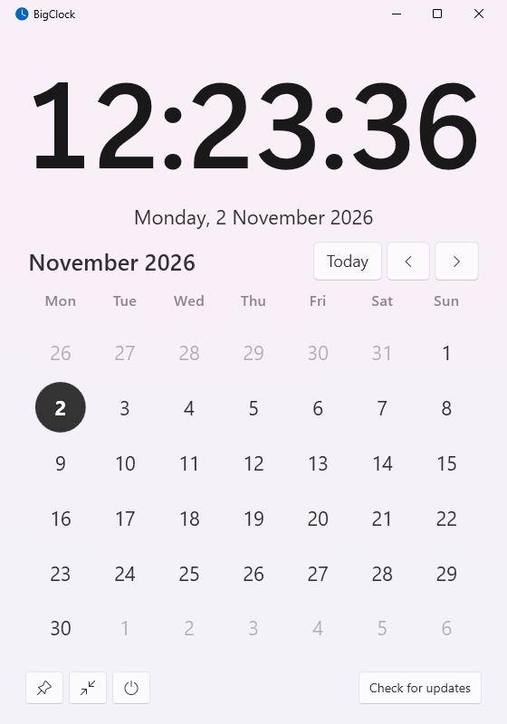

# BigClock

A big, readable clock and month calendar for Windows, for when the taskbar clock is too small to find.



## Download

Get `BigClock.exe` from the [latest release](https://github.com/PantaKoda/BigClock/releases/latest) and run it from any folder you can write to, such as `%LOCALAPPDATA%\Programs\BigClock`. There is nothing to install and .NET is included.

The exe is not code-signed, so Windows SmartScreen may warn on first run. Choose **More info**, then **Run anyway**.

## Features

- **Big clock:** the time grows with the window. It follows your Windows regional format for 12/24-hour time, date, language and first day of the week.
- **Calendar:** today is highlighted. Change month with the arrows, the mouse wheel or the Left/Right keys, and press Home or **Today** to come back.
- **Always on top** (pin button): keeps the clock in view over other windows.
- **Clock only** (arrows button): hides the calendar for a small floating clock.
- **Start with Windows** (power button).
- **Check for updates:** asks GitHub for the latest release. If there is a newer one the button becomes **Install vX.Y.Z**; click it to download, verify and restart into the new version. BigClock only contacts GitHub when you click this button.

Light and dark themes follow Windows. Settings are stored in `%APPDATA%\BigClock\settings.json`.

## Build from source

Requires the [.NET 10 SDK](https://dotnet.microsoft.com/download).

```bash
dotnet test tests/BigClock.Tests
```

```bash
dotnet run --project src/BigClock
```

## Publishing a release

Push a version tag. GitHub Actions runs the tests, builds `BigClock.exe` with that version and creates the release, which the update button then picks up.

```bash
git tag v1.1.0
```

```bash
git push origin v1.1.0
```

## License

[MIT](LICENSE)
